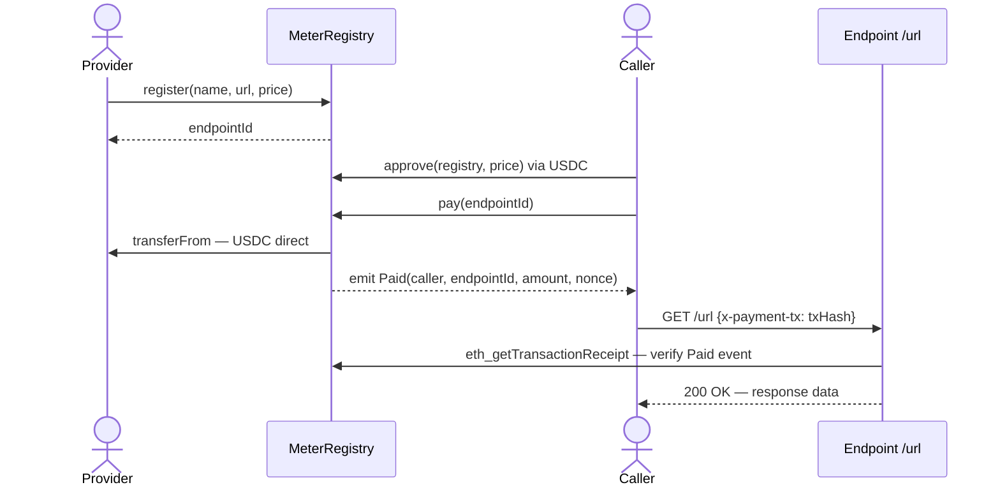
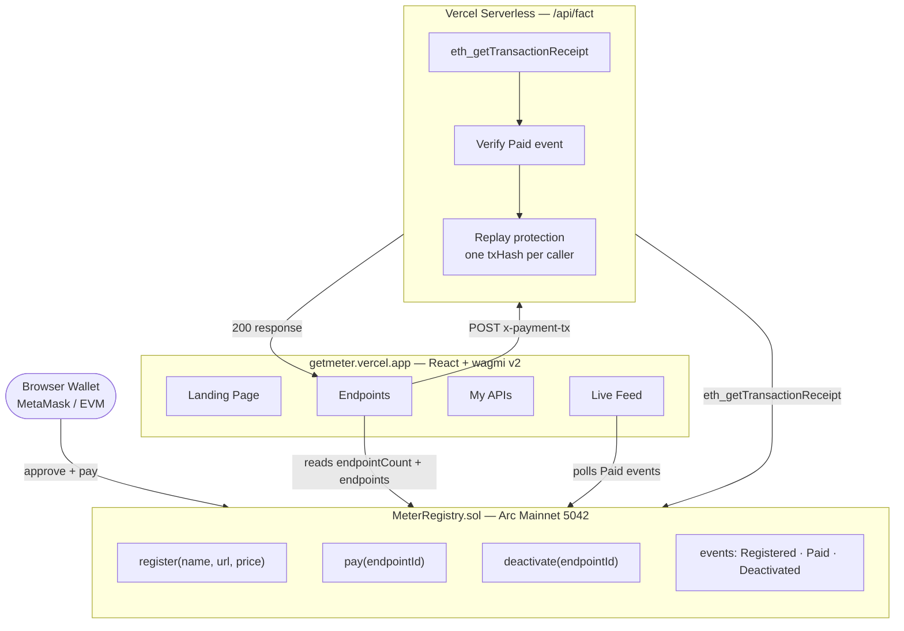

<div align="center">


# Meter

**Pay-per-call API gateway. USDC settles every request. The contract is the auth layer.**

[](https://getmeter.vercel.app)
[](https://explorer.arc.io/address/0x423B8701Da3a251a3A3fc2d241b71e8d05744C91)
[](contracts/test/MeterRegistry.t.sol)
[](contracts/MeterRegistry.sol)
[](LICENSE)

</div>

---

[](https://getmeter.vercel.app)

## What it does

Meter lets any HTTP endpoint charge per call in USDC — no API keys, no accounts, no billing infrastructure. A provider registers their endpoint onchain with a price. A caller approves USDC, calls `pay()`, and passes the transaction hash as proof of payment. The endpoint verifies the `Paid` event onchain and responds.

USDC flows **directly from caller to provider** in a single transaction. The contract never holds funds.



---

## Live on Arc Mainnet

| | |
|---|---|
| **Contract** | [`0x423B8701Da3a251a3A3fc2d241b71e8d05744C91`](https://explorer.arc.io/address/0x423B8701Da3a251a3A3fc2d241b71e8d05744C91) |
| **Network** | Arc Mainnet — chain ID `5042` |
| **USDC** | [`0x3600000000000000000000000000000000000000`](https://explorer.arc.io/address/0x3600000000000000000000000000000000000000) |
| **First payment tx** | [`0x14877...b5a5`](https://explorer.arc.io/tx/0x1487799a93150e66c0a70e6072fefabd4a935b4d9d3f3da95d4faa68e5f6b5a5) |
| **Demo endpoint** | ID `1` — "random fact" — 0.01 USDC/call |

---

## Architecture



### Design decisions

| Decision | Rationale |
|---|---|
| No fund custody | USDC transfers directly caller → provider via `transferFrom`. Zero protocol risk. |
| No owner / admin | Fully immutable after deploy. No upgrade key, no rug vector. |
| `active` flag | Providers can disable a listing if their address is Circle-blocklisted. |
| Nonce per endpoint | Each `Paid` event carries an incrementing nonce — unique call identifier within an endpoint's history. |
| Zero-dependency serverless | `/api/fact` uses only Node `https` built-in. No cold-start bundling issues on Vercel. |

---

## Contract interface

```solidity
// Register a new endpoint
function register(
    string calldata name,
    string calldata url,
    uint256 price          // USDC — 6 decimals (e.g. 10000 = 0.01 USDC)
) external returns (uint256 endpointId);

// Pay for a call — transfers USDC caller → provider atomically
function pay(uint256 endpointId) external;

// Provider disables their own endpoint
function deactivate(uint256 endpointId) external;

// Events
event Registered(address indexed provider, uint256 indexed endpointId, string name, string url, uint256 price);
event Paid(address indexed caller, uint256 indexed endpointId, uint256 amount, uint256 nonce);
event Deactivated(address indexed provider, uint256 indexed endpointId);
```

### Custom errors

| Error | Condition |
|---|---|
| `ZeroPrice()` | `register()` with `price == 0` |
| `ZeroAddress()` | Constructor with zero USDC address |
| `EndpointNotFound()` | ID out of range |
| `EndpointInactive()` | `pay()` on a deactivated endpoint |
| `NotProvider()` | `deactivate()` by non-provider |
| `PaymentFailed()` | `transferFrom` returned `false` |

---

## Caller integration

```typescript
// 1. Approve USDC spend once (or per-call)
await walletClient.writeContract({
  address: '0x3600000000000000000000000000000000000000',  // USDC on Arc
  abi: erc20Abi,
  functionName: 'approve',
  args: ['0x423B8701Da3a251a3A3fc2d241b71e8d05744C91', price],
})

// 2. Pay — USDC moves in this single tx
const txHash = await walletClient.writeContract({
  address: '0x423B8701Da3a251a3A3fc2d241b71e8d05744C91',
  abi: meterRegistryAbi,
  functionName: 'pay',
  args: [endpointId],
})

// 3. Call the endpoint — tx hash is the payment proof
const res = await fetch(endpointUrl, {
  headers: { 'x-payment-tx': txHash },
})
```

## Provider payment gate

```typescript
// Minimal onchain verification — see api/fact.ts for full implementation
const receipt = await rpc('eth_getTransactionReceipt', [txHash])
const PAID_TOPIC = '0x...' // keccak256('Paid(address,uint256,uint256,uint256)')

const log = receipt.logs.find(l =>
  l.address.toLowerCase() === METER_REGISTRY.toLowerCase() &&
  l.topics[0] === PAID_TOPIC &&
  BigInt(l.topics[2]) === BigInt(endpointId)
)

if (!log) return res.status(402).json({ error: 'Payment required' })
```

---

## Development

### Prerequisites

- [Bun](https://bun.sh) ≥ 1.0
- [Foundry](https://book.getfoundry.sh) for contract work
- An EVM wallet with USDC on Arc Mainnet

### Install

```bash
git clone https://github.com/thesithunyein/meter
cd meter
bun install
```

### Environment

```bash
cp .env.example .env
```

| Variable | Purpose |
|---|---|
| `VITE_METER_REGISTRY_ADDRESS` | MeterRegistry contract address |
| `DEMO_ENDPOINT_ID` | Endpoint ID for the `/api/fact` demo |
| `RPC_PROXY_BASE_URL` | RPC proxy base URL (Arc Studio only) |
| `RPC_PROXY_TOKEN` | RPC proxy auth token (Arc Studio only) |
| `RPC_PROXY_CHAINS` | Proxy chain keys, comma-separated (Arc Studio only) |

### Run

```bash
bun run server   # API server on :3001
bun run dev      # Frontend on :5173
```

### Test

```bash
forge test -v
forge test --gas-report
```

### Build

```bash
bun run build
bun run check    # lint + typecheck
```

### Deploy contract

```bash
export PRIVATE_KEY=0x...

forge script contracts/script/DeployMeterRegistry.s.sol:DeployMeterRegistry \
  --rpc-url https://rpc.mainnet.arc.io \
  --broadcast \
  --private-key $PRIVATE_KEY
```

---

## Project structure

```
meter/
├── api/
│   └── fact.ts                    # Vercel serverless — payment-gated endpoint
├── contracts/
│   ├── MeterRegistry.sol          # Core registry contract
│   ├── script/
│   │   └── DeployMeterRegistry.s.sol
│   └── test/
│       └── MeterRegistry.t.sol    # 22 Foundry tests + 256 fuzz runs
├── server/
│   └── index.ts                   # Bun dev server (local /api/fact)
├── src/
│   ├── App.tsx
│   ├── components/
│   │   ├── EndpointCard.tsx
│   │   ├── HeroCard.tsx
│   │   ├── LandingPage.tsx
│   │   ├── LiveFeed.tsx
│   │   ├── MeterLogo.tsx
│   │   ├── ProviderPage.tsx
│   │   └── PublicPage.tsx
│   └── contracts/
│       └── meter-registry.ts
├── public/
│   └── logo.svg
└── vercel.json
```

---

## Contributing

Pull requests are welcome. For substantial changes, open an issue first.

1. Fork the repository
2. Create a feature branch: `git checkout -b feat/your-feature`
3. Commit: `git commit -m 'feat: describe the change'`
4. Push: `git push origin feat/your-feature`
5. Open a pull request

Please follow the [Code of Conduct](CODE_OF_CONDUCT.md).

---

## Security

See [SECURITY.md](SECURITY.md) for the vulnerability disclosure policy and known design tradeoffs.

---

## License

[MIT](LICENSE)
